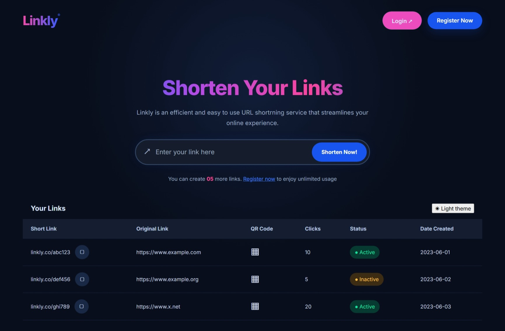

# Linkly — URL Shortener & Link Analytics

**Shorten your links. Share them easily. Track your clicks.**
## Home Page




Linkly is a full-stack URL shortening application that transforms long URLs into short, shareable links. It includes user authentication, link management, click tracking, and QR-code generation in a simple dashboard.

The project was built to practise full-stack web development, REST API design, database relationships, authentication, and integration between a React frontend and a Flask backend.

## Features

- **User Authentication:** Register and log in securely using password hashing and JWT-based authentication.
- **URL Shortening:** Generate unique short codes for long URLs.
- **Link Management:** Create, view, update, and delete shortened URLs.
- **Click Analytics:** Track visits to shortened links and retrieve analytics for individual URLs.
- **QR-Code Generation:** Generate QR codes for shortened links for convenient sharing.
- **Redirect Handling:** Redirect visitors from a short URL to its original destination.
- **Dashboard:** View and manage your shortened links in one place.
- **Theme Switching:** Switch between light and dark themes.
- **Protected API Endpoints:** Restrict private link-management operations to authenticated users.

## Tech Stack

### Frontend
- React
- Vite
- React Router
- Axios
- Zustand
- CSS

### Backend
- Python
- Flask
- Flask-SQLAlchemy
- Flask-JWT-Extended
- Flask-CORS

### Database and Utilities
- SQLite for local development
- SQLAlchemy ORM
- QR-code generation with Python QR-code tooling
- Pytest for testing

## How It Works

1. A user registers or logs in to Linkly.
2. The user submits a long URL.
3. The Flask API generates a unique short code and stores the URL.
4. Linkly displays the shortened URL in the dashboard.
5. When someone visits the short link, the backend records the click and redirects the visitor to the original URL.
6. The dashboard retrieves analytics and displays click counts.
7. Users can generate QR codes for their shortened links.

## Project Structure

```text
linkly/
├── backend/
│   ├── app/
│   │   ├── models/
│   │   │   ├── user.py
│   │   │   ├── url.py
│   │   │   └── click.py
│   │   ├── routes/
│   │   │   ├── auth.py
│   │   │   ├── urls.py
│   │   │   └── redirect.py
│   │   ├── utils/
│   │   │   └── shortener.py
│   │   ├── extensions.py
│   │   └── __init__.py
│   ├── tests/
│   ├── config.py
│   ├── run.py
│   └── requirements.txt
│
├── frontend/
│   ├── src/
│   │   ├── components/
│   │   ├── pages/
│   │   ├── services/
│   │   ├── stores/
│   │   ├── App.jsx
│   │   └── main.jsx
│   ├── .env.example
│   └── package.json
│
└── README.md
```


## Getting Started

### Prerequisites

Install the following before running Linkly:

- Python 3.12 or a compatible Python version
- Node.js and npm
- Git

### 1. Clone the repository

```bash
git clone https://github.com/Fikayomi31/linkly
cd linkly
```

### 2. Set Up the Backend

Open a terminal and navigate to the backend directory:

```bash
cd backend
python -m venv venv
```

Activate the virtual environment.

**Windows PowerShell:**

```powershell
.\venv\Scripts\Activate.ps1
```

Install the Python dependencies:

```bash
pip install -r requirements.txt
```

Create a `.env` file in the backend directory and configure your environment variables:

```dotenv
SECRET_KEY=replace_with_a_secure_random_secret
JWT_SECRET_KEY=replace_with_a_different_secure_random_secret
DATABASE_URL=sqlite:///linkly.db
```

Generate secure secrets rather than using the example placeholders. Never commit your `.env` file or production secrets to GitHub.

Start the backend using your project's configured entry point:

```bash
python run.py
```

The API should be available at:

```text
http://127.0.0.1:5000
```

### 3. Set Up the Frontend

Open a second terminal:

```bash
cd frontend
npm install
```

Create a `.env.local` file in the frontend directory:

```dotenv
VITE_API_BASE_URL=http://127.0.0.1:5000/api
```

Start the development server:

```bash
npm run dev
```

Open the local frontend URL printed by Vite, commonly:

```text
http://localhost:5173
```

Keep both development servers running while using the application.

## API Endpoints

The following table describes the main API operations. Confirm exact route names and HTTP methods against your current Flask implementation.

| Method | Endpoint | Purpose |
|---|---|---|
| POST | `/api/register` | Register a user |
| POST | `/api/login` | Authenticate a user |
| GET | `/api/me` | Retrieve the authenticated user's profile |
| POST | `/api/urls` | Create a shortened URL |
| GET | `/api/urls` | List the user's URLs |
| GET | `/api/urls/<id>` | Retrieve a URL |
| PUT | `/api/urls/<id>` | Update a URL |
| DELETE | `/api/urls/<id>` | Delete a URL |
| GET | `/api/urls/<id>/analytics` | Retrieve URL analytics |
| GET | `/api/urls/<id>/qr` | Retrieve a QR code, if registered at this path |
| GET | `/<short_code>` | Redirect to the original URL |

Private endpoints require a valid access token in the request's `Authorization` header:

```http
Authorization: Bearer YOUR_ACCESS_TOKEN
```

## Database Models

Linkly uses three main data models:

- **User:** Stores user account information and password hashes.
- **URL:** Stores original URLs, unique short codes, ownership, and relevant timestamps or status fields.
- **Click:** Stores recorded visits to shortened URLs, including available metadata such as timestamps, referrers, and user-agent information.

A user can own multiple URLs, and each URL can have multiple click records.

## Testing

The backend uses Pytest for automated tests.

From the backend directory, run:

```bash
pytest
```

Run the tests before submitting changes to help catch regressions in models, authentication, URL management, and redirect behaviour.

## Security Considerations

- Passwords should be hashed and never stored as plain text.
- JWT signing secrets should be strong, private, and configured through environment variables.
- Protected endpoints should verify authentication and URL ownership.
- Validate submitted URLs and handle invalid input safely.
- Configure CORS to allow only the frontend origins you trust.
- Avoid committing `.env` files, credentials, or production secrets.
- Consider rate limiting and abuse prevention before exposing a URL shortener publicly.

## Future Improvements

- More detailed analytics and click-history charts.
- Search, filtering, and pagination for shortened links.
- Custom short codes and optional link expiration.
- Link editing and activation controls in the dashboard.
- Rate limiting and abuse detection.
- Automated frontend and backend tests in CI.
- Production deployment with a managed database.

## What I Learned

Building Linkly has helped me practise:

- Designing and connecting a React frontend to a Flask REST API.
- Implementing authentication and protected endpoints.
- Modelling relationships between users, URLs, and click records.
- Generating unique short codes and handling redirects.
- Integrating QR-code generation and analytics.
- Managing application state and API requests in React.
- Debugging integration issues across the frontend and backend.

## Author

**Fikayo Ogundijo**

Full-stack developer focused on building practical web applications with Python, Flask, React, and REST APIs.

- GitHub: https://github.com/Fikayomi31/

